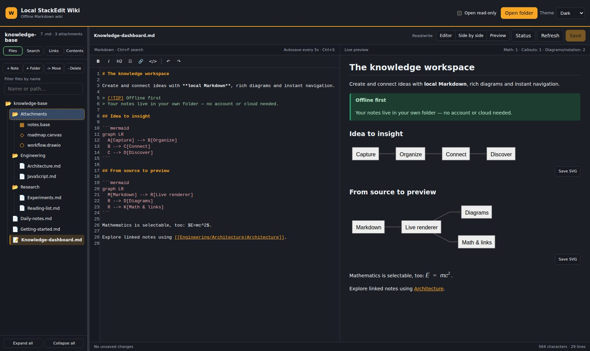

# Local StackEdit Wiki

**Your notes. Your files. Your computer.**

A fully offline, portable Markdown knowledge base for Chrome and Edge. Write in a familiar editor, browse your own folder tree, and preview diagrams, math, media and connected notes — **without creating an account or uploading your wiki**.

[**Get the latest tested offline ZIP**](https://github.com/nibage/local-stackedit-wiki/actions/workflows/offline-release.yml) · [**Source code**](https://github.com/nibage/local-stackedit-wiki) · [**Roadmap**](TODO.md)

> **Offline first:** Unzip the completed GitHub Actions artifact, open `index.html` in Chrome/Edge, then use **Open folder** to choose the wiki directory. No server, cloud storage or external runtime dependencies.

## The experience



*Captured in Chromium from the actual current application and verified offline renderer bundle, with a curated demonstration note. No composited or generated UI elements.*

| Write in Markdown | Connect your ideas | Explore visually |
|---|---|---|
| Syntax highlighting, formatting toolbar, live preview and safe autosave | Full-text search, in-links, out-links, Back and separate heading outline | Editable Canvas graphs, read-only Bases tables, draw.io diagrams, Mermaid and MathJax |

### Designed for your files

- **Markdown-first.** Open existing `.md` and `.markdown` files. No proprietary cloud database or content import step.
- **One local wiki folder.** Browse nested directories, filter filenames, create notes and folders, and use guarded drag-and-drop moves. Folder moves verify copied bytes and require confirmation.
- **Linked notes.** Out-links and in-links navigate to individual link occurrences; Contents provides a separate clickable heading outline with source cursor positioning.
- **Rich previews.** Use `![[Attachments/example.canvas]]`, `![[Attachments/example.base]]` or `![[Attachments/example.drawio]]` to display structured viewers inside Markdown. MathML text is selectable; MathJax retains its context menu. Mermaid and ABCjs can export SVG. Attachments include images, audio/video, PDFs, JSON Canvas, Obsidian Bases and `.drawio` diagrams.
- **Safety by default.** Read-only mode is available, deletion requires opting into **- Delete** and a confirmation prompt, and structured previews do not execute embedded code.

## Getting started

1. Open [GitHub Actions — Build complete offline wiki ZIP](https://github.com/nibage/local-stackedit-wiki/actions/workflows/offline-release.yml), choose the latest **successful** run and download the `local-stackedit-wiki-offline` artifact. GitHub may require sign-in to access workflow artifacts.
2. Extract the ZIP to a permanent application folder. The ZIP contains the offline runtime and essential documentation, not the development tests.
3. Open **`index.html`** directly in a current version of Chrome or Edge (preferably on desktop).
4. Select **Open folder** and grant the browser access to a folder you own. Keep a backup of your original data before writing or moving files.
5. Choose **Side by side**, **Editor** or **Preview**. Edits autosave after approximately five seconds when permitted; **Ctrl+S** saves immediately. The Markdown preview refreshes after three seconds without further typing, to avoid images flashing during rapid edits.

**Tip:** The source repository includes `demo-wiki/` for experiments, but the lean user ZIP intentionally does not bundle the large testing vault. Clone the source repository to explore the demo.

### Navigation and file safety

**Files** is the folder tree, with familiar 📁 closed-folder, 📂 open-folder, 📄 Markdown and 📝 active-note icons. All four file action buttons remain on one row. **Search** finds words in note contents. **Links** lists Out-links and In-links with source positions. **Contents** navigates headings. **← Back** returns to the previous note.

**→ Move** enables dragging notes, attachments and folders to an existing directory. Folder moves copy and verify the complete subtree, require confirmation, and conservatively migrate local Markdown/wikilinks and common attachment references. The browser filesystem does not offer atomic multi-file transactions, so maintain backups. **- Delete** starts **off**: turn it on to reveal trash icons on hover or focus; permanent removal still requires confirmation.

**Canvas editing:** Open a `.canvas` attachment, choose **Open larger** if it was embedded, then **Edit canvas**. Select or drag a card, resize using its ↘ corner, modify fields below the graph, add new cards, or use **Connect →** followed by a target card. Undo/Redo and **Save canvas** work only in this large dialog; the save refuses external changes and the folder must be writable. **Preview** returns to the read-only graph. Save first, or explicitly discard your draft before leaving.

**Bases table controls:** Open a `.base` file or embed. Click **Filter (temporary)** to add up to eight conditions, combine them using AND/OR/NOT, or reset them. Click a column header to cycle ascending/descending/original order. Drag the grip at a column's right edge (or use Left/Right arrows while focused) to resize, and double-click the grip to auto-fit. These controls affect the current viewer only; they do not save YAML or edit Markdown frontmatter.

**Editing a `.base` file:** In a writable wiki, open the `.base` in **Open larger** and click **Edit Base YAML**. The editor preserves the text you do not change, including comments and unfamiliar fields. It validates the supported safe YAML subset before **Save Base**, verifies the on-disk fingerprint, and asks before discarding unsaved changes. This is a source YAML editor; it does **not** persist the temporary graphical filters or change property cells in Markdown notes. In read-only mode the editing button is hidden.

**StackEdit HTML reference:** The captured StackEdit document uses **Lato / Helvetica Neue / Helvetica**, **18px** editor and preview text at **1.67** line height, and a roughly **990px** text column at full width (386px padding each side of a 1762px panel). The optional StackEdit theme now follows those measured values. It uses the locally available Lato font when installed and falls back to Helvetica/Arial without downloading fonts, preserving fully offline behavior.

**Compact workspace and synced scrolling:** The application title and the current file/mode, layout, export, Status, Refresh and Save controls now share a compact top header instead of occupying two tall bars. A single full-width formatting toolbar sits above both Markdown and Preview panes, with a **Scroll sync: Off / On** button on its right. Turn it on in **Side by side** mode to link editor and preview scrolling in both directions by relative document position; this toggle is stored only for the current application instance and does not alter files. The Markdown/preview heading strips are removed, and their help information appears in the bottom status bar. The status strip retains saved/unsaved and rendering status while adding UTF-8 source bytes, words, line count, live cursor line/column, JavaScript source characters, and rendered HTML source characters, visible text words and paragraph count. Markdown text is now horizontally centered at comfortable reading width in **all** color themes; the StackEdit theme uses a narrower ~990 px editor and preview, 18 px Arial-based text and clearly visible CodeMirror line numbers. The HTML counts represent the actual last rendered preview and may briefly lag the Markdown source during the existing 3-second preview debounce. On smaller windows the toolbar icons scroll without hiding the sync button, and the status bar itself scrolls horizontally rather than growing taller.

**StackEdit reading mode:** Choose **StackEdit** from the Theme selector (alongside System, Light and Dark) to use a neutral white reading canvas, a centred wide reading column, more generous typography, a dark minimalist formatting strip and a larger, comfortable Markdown editor. The choice is stored per wiki application instance and does not change any source files. The toolbar is intentionally one horizontal row with scrolling on narrow screens and supports Bold, Italic, Strikethrough, H2, unordered/ordered/checklist, blockquote, inline and fenced code, tables and links, with Undo/Redo. The seven attachment buttons (image, video, audio, PDF, JSON Canvas, Obsidian Base, draw.io) offer a searchable, local-only list of matching files from the currently opened wiki; choosing an existing file inserts a relative link/embed at the cursor without uploading or copying the asset. They only work when a writable Markdown note is open.

**PDF reading layout:** The PDF button continues to open Chrome/Edge's native print dialog. It now applies a StackEdit-like centred ~470pt article column, 12pt body text, spacious headings and light background regardless of app theme. External HTTPS and mailto links remain clickable. Same-document heading links (including supported Obsidian heading references) are mapped to actual in-PDF section anchors. Standalone **HTML** remains a faithful snapshot of the currently chosen on-screen theme. For the PDF choose **Save as PDF** and enable print backgrounds in the browser if needed for visual assets. Local links to *other* wiki notes cannot be made portable within a single exported PDF/HTML file and are not fabricated.

**Preview export:** The active **Editor / Side by side / Preview** layout button has a calm green highlight. A separate **▾** arrow immediately beside the **Preview** layout button opens export choices without changing the height of the preview pane. Use this compact dropdown: **HTML** downloads a single standalone `.html` file containing the *rendered* preview and embedded local images/diagrams with inline styling for the current theme. **PDF…** opens a print-ready copy of the same preview in **light mode**, regardless of whether the app is in light or dark mode; Chrome/Edge's print dialog lets you choose **Save as PDF**. The app's theme is not changed. Export waits for pending live-preview rendering and does not save/modify your Markdown note. It is available whenever a note is open and the preview pane is visible. The browser print engine may paginate differently from on-screen scrolling; embedded video/audio or an embedded PDF cannot be represented as playable media in the printed PDF. Huge media resources above 32 MB each (64 MB total) block standalone export rather than silently embedding incomplete data. Downloads stay local; no cloud services.

**Refresh** rescans disk contents and keeps expanded branches. **Status** displays the bundled renderer status and diagnostic tools. On a complete release, all four renderer dependencies should report ready; developer checkouts may need separate installation.

## Technical guide

### Requirements and architecture

| Component | Implementation |
|---|---|
| Runtime | Static HTML, CSS and plain JavaScript; direct `file://` use |
| File access | Chromium File System Access API, with read-only fallback where available |
| Markdown editing | CodeMirror, marked, Prism; offline sanitization |
| Mathematics and notation | MathJax MathML, Mermaid and ABCjs (pinned, verified offline bundles) |
| Structured files | JSON Canvas visual editor in Open larger (writable mode only), read-only inline Canvas excerpts; Bases read-only tables with adjustable columns, temporary filters and sorting (limited YAML/filter syntax); draw.io read-only basic SVG viewer |
| Storage | Your chosen wiki folder; preferences scoped to this `index.html` installation |
| Distribution | GitHub Actions verified offline ZIP; no tests, build tools or demo vault in the download |

### Known limitations

- Only supported Chrome/Edge environments offer writable directory access. A source checkout may have placeholder renderer assets; use the verified ZIP for offline use.
- Canvas editing is a first-stage implementation, not full Obsidian parity. In **Open larger**, writable folders offer **Edit canvas** with move/resize, node property edits, adding cards and connections, Undo/Redo and guarded Save/Discard. Inline embeds remain read-only, and unsupported JSON Canvas constructs must not be silently rewritten. Canvas file cards can display bounded local Markdown excerpts; external links and arbitrary HTML remain inert. Bases supports temporary filters and sortable/resizable table columns, plus a guarded YAML source editor in the large dialog. It does not yet support GUI persistence of filters or Markdown frontmatter cell editing. The editable YAML must use the supported safe subset.
- The `.drawio` viewer approximates complex/custom shapes; use [diagrams.net](https://www.diagrams.net/) for full-fidelity editing. Audio/video playback and PDFs depend on browser codecs and support.
- Rewriting references inside structured Canvas and Bases files is not yet automatic when moving referenced attachments. For advanced features see [TODO.md](TODO.md).
- Deleting a folder is permanent, and no browser API can make a multi-file move fully atomic. Back up important information.

### Development and verification

```sh
node --test tests/*.test.cjs
python tools/release-audit.py
python tests/offline-release-build.test.py
```

GitHub Actions also runs Playwright/Chromium smoke tests with the **actual verified release ZIP**. To build a release from source, run `python tools/build-offline-release.py --output local-stackedit-wiki-offline.zip` (downloads only pinned npm archives during packaging), or provide the documented offline npm cache. Runtime usage never downloads libraries.

For details, see [attachment compatibility](docs/OBSIDIAN_ATTACHMENTS.md), [renderer details](docs/RENDERERS.md), [publishing](GITHUB_PUBLISH.md), and [the full roadmap](TODO.md). Historical implementation notes remain in `docs/` for reference rather than being part of the user ZIP.

---

**Local StackEdit Wiki is an independent offline Markdown application.** It is not affiliated with Obsidian, StackEdit or diagrams.net. Third-party rendering libraries retain their own upstream licenses.

The application includes a local SVG favicon matching its amber **W** identity, without external image requests.

### Editing and deletion behavior

While editing, the preview remains stable until you stop typing for **three seconds**. When it updates, it follows the paragraph at the editor caret (or the bottom when editing the final lines). Local image URLs and their displayed dimensions are reused between redraws; deliberate scrolling in the preview still takes priority. Switching from one Markdown note to another **saves the current note first**. If the save fails or the file changed outside the app, the switch is blocked and the unsaved editor content is kept.

The opt-in trash button opens a centered, themed confirmation dialog rather than a native browser confirm. Nonempty folders require an additional in-dialog acknowledgement, and cancelling leaves the data untouched.

**Canvas editing interaction:** Card movement/resize now tracks the real visible node coordinates, redraws connected arrows continuously during the pointer gesture and preserves board pan/zoom when the change is committed. Resize handles appear only on hover/focus or selection and remain in their card's stacking context. The temporary Bases filter controls and view tabs share one horizontal row with a divider; the **NOT** checkbox stays inline. Draw.io approximation notices overlay the viewport instead of resizing the dialog.

**Canvas editor compact UI (November 2026):** In a writable Canvas attachment's **Edit canvas** view, the path row now also displays save state and selection hint, card/connection counts, and drag/resize/zoom help. The action buttons and − / + / Fit / 100% / percentage zoom controls share one horizontal toolbar; **Undo**, **Redo**, **Save canvas**, and **Preview** have outline icons (Preview has a back arrow). If you try to close or return to preview with a dirty draft, only **Discard changes** and **Keep editing** appear at the right of that same toolbar instead of opening an extra message row. The stable, compact two-row inspector has small inline X/Y/width/height controls, editable content/color/delete controls, and an adjacent list of connections. Click a selected card again (or click empty canvas space) to deselect it; keyboard Enter/Space does the same. Guarded saving and conflict protection are unchanged.

**TOC and reading controls (November 2026):** Clicking a heading in **Contents** no longer forces Side by side. **Editor** moves the caret and editor viewport to the source heading; **Preview** scrolls the rendered section without opening or focusing the editor; **Side by side** moves both. The same layout-preserving behavior applies to same-document heading link navigation. On the shared toolbar immediately before **Scroll sync**, **Center** toggles between centered document columns and left-aligned full-width text, **Line numbers** shows/hides CodeMirror source line numbering, and **Text size** changes editor plus preview font size (Default, 12–26 px) across all themes. These settings are saved to this offline app instance, not into any Markdown file.

**Canvas edit controls (November 2026):** The Canvas **Preview** back action is in the attachment dialog footer beside **Insert into note**, while creation/Connect/Undo/Redo are followed by a divider and zoom controls (-, +, Fit, 100%, current percentage). **Save canvas** sits at the far right, with the unsaved/saved state directly above it. The two informational spans (card/connection counts and drag/resize/zoom guide) are joined at the bottom left with a separator. FILE/URL/LABEL content has a wider input, the color input fits a hex value, and **Delete card** is directly below **Delete connection** with the same width. Dirty-close confirmation still guards unsaved drafts.

**Quick note and compact navigation (November 2026):** After opening a wiki with read/write permission, you can start typing in the empty editor without selecting a note. The app creates **Untitled.md** in the wiki root (or **Untitled 2.md**, **Untitled 3.md**, etc., if occupied), preserving your first keystrokes and following the normal guarded autosave process. Nothing is created if the folder is closed or open read-only. The file title is now beside the app logo, where it has room to grow; unusually long paths display an ellipsis with the full path on hover. The **Read/write / Read-only** mode and `.md`/attachment counts have moved into the bottom status bar. Very narrow sidebars truncate the Contents label and root folder title instead of allowing text to overflow.

**StackEdit HTML fidelity (November 2026):** The optional StackEdit theme has been refined against the supplied full offline StackEdit HTML capture. In addition to its 990px reading column and 18px Lato/Helvetica typography at 1.67 line height, its preview now uses the source's #0c93e4 links, ~1.8em heading spacing without decorative heading rules, unboxed tables, lightly shaded code, quieter inline code, neutral blockquotes and the original heading scale. CodeMirror uses the same editorial font stack, subdued Markdown syntax colors and neutral gutters. No external CSS or downloadable font dependency is introduced; if Lato is not installed, Helvetica/Arial is used as the local fallback. Other themes remain unchanged.
