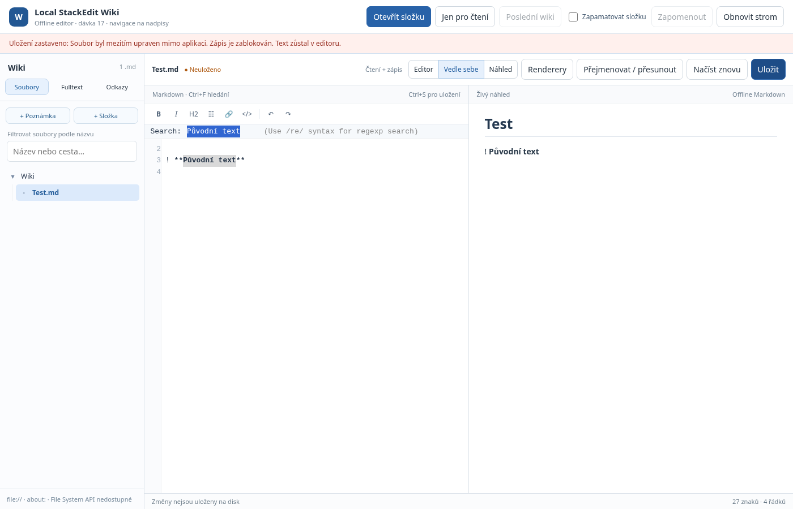
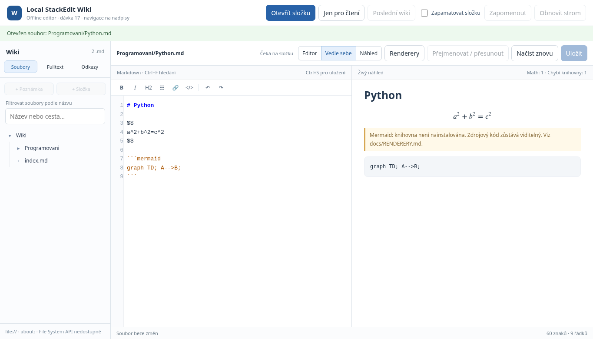
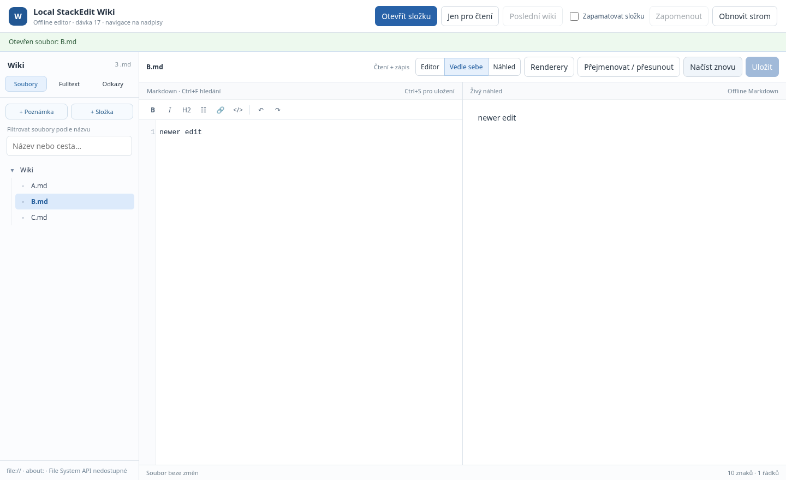

# Local StackEdit Wiki

**Your notes. Your files. Your computer.**

A fully offline, portable Markdown knowledge base for Chrome and Edge. Write in a familiar editor, browse your own folder tree, and preview diagrams, math, media and connected notes — **without creating an account or uploading your wiki**.

[**Get the latest tested offline ZIP**](https://github.com/nibage/local-stackedit-wiki/actions/workflows/offline-release.yml) · [**Source code**](https://github.com/nibage/local-stackedit-wiki) · [**Roadmap**](TODO.md)

> **Offline first:** Unzip the completed GitHub Actions artifact, open `index.html` in Chrome/Edge, then use **Open folder** to choose the wiki directory. No server, cloud storage or external runtime dependencies.

## The experience



*Real browser screenshot from the project's visual regression tests. Current buttons and colors may vary slightly.*

| Write in Markdown | Connect your ideas | Explore visually |
|---|---|---|
| Syntax highlighting, formatting toolbar, live preview and safe autosave | Full-text search, in-links, out-links, Back and separate heading outline | Local Canvas graphs, read-only Bases tables, draw.io diagrams, Mermaid and MathJax |

<details>
<summary>More screenshots</summary>

| Wiki layout | Interface smoke test |
|---|---|
|  |  |

These are real development screenshots, not mockups. They document representative layouts; the latest UI may differ.

</details>

### Designed for your files

- **Markdown-first.** Open existing `.md` and `.markdown` files. No proprietary cloud database or content import step.
- **One local wiki folder.** Browse nested directories, filter filenames, create notes and folders, and use guarded drag-and-drop moves. Folder moves verify copied bytes and require confirmation.
- **Linked notes.** Out-links and in-links navigate to individual link occurrences; Contents provides a separate clickable heading outline with source cursor positioning.
- **Rich previews.** Use `![[Attachments/example.canvas]]`, `![[Attachments/example.base]]` or `![[Attachments/example.drawio]]` to display structured viewers inside Markdown. MathML text is selectable; MathJax retains its context menu. Mermaid and ABCjs can export SVG. Attachments include images, audio/video, PDFs, JSON Canvas, Obsidian Bases and `.drawio` diagrams.
- **Safety by default.** Read-only mode is available, deletion requires opting into **- Delete** and a confirmation prompt, and structured previews do not execute embedded code.

## Getting started

1. Open [GitHub Actions — Build complete offline wiki ZIP](https://github.com/nibage/local-stackedit-wiki/actions/workflows/offline-release.yml), choose the latest **successful** run and download the `local-stackedit-wiki-offline` artifact. GitHub may require sign-in to access workflow artifacts.
2. Extract the ZIP to a permanent application folder. The ZIP contains the offline runtime and essential documentation, not the development tests.
3. Open **`index.html`** directly in a current version of Chrome or Edge (preferably on desktop).
4. Select **Open folder** and grant the browser access to a folder you own. Keep a backup of your original data before writing or moving files.
5. Choose **Side by side**, **Editor** or **Preview**. Edits autosave after approximately five seconds when permitted; **Ctrl+S** saves immediately. The Markdown preview refreshes after three seconds without further typing, to avoid images flashing during rapid edits.

**Tip:** The source repository includes `demo-wiki/` for experiments, but the lean user ZIP intentionally does not bundle the large testing vault. Clone the source repository to explore the demo.

### Navigation and file safety

**Files** is the folder tree, with all four action buttons on one row. **Search** finds words in note contents. **Links** lists Out-links and In-links with source positions. **Contents** navigates headings. **← Back** returns to the previous note.

**→ Move** enables dragging notes, attachments and folders to an existing directory. Folder moves copy and verify the complete subtree, require confirmation, and conservatively migrate local Markdown/wikilinks and common attachment references. The browser filesystem does not offer atomic multi-file transactions, so maintain backups. **- Delete** starts **off**: turn it on to reveal trash icons on hover or focus; permanent removal still requires confirmation.

**Refresh** rescans disk contents and keeps expanded branches. **Status** displays the bundled renderer status and diagnostic tools. On a complete release, all four renderer dependencies should report ready; developer checkouts may need separate installation.

## Technical guide

### Requirements and architecture

| Component | Implementation |
|---|---|
| Runtime | Static HTML, CSS and plain JavaScript; direct `file://` use |
| File access | Chromium File System Access API, with read-only fallback where available |
| Markdown editing | CodeMirror, marked, Prism; offline sanitization |
| Mathematics and notation | MathJax MathML, Mermaid and ABCjs (pinned, verified offline bundles) |
| Structured files | JSON Canvas read-only graph with local note excerpts; Bases read-only table with limited YAML/filter syntax; draw.io read-only basic SVG viewer |
| Storage | Your chosen wiki folder; preferences scoped to this `index.html` installation |
| Distribution | GitHub Actions verified offline ZIP; no tests, build tools or demo vault in the download |

### Known limitations

- Only supported Chrome/Edge environments offer writable directory access. A source checkout may have placeholder renderer assets; use the verified ZIP for offline use.
- Canvas and Bases viewers do not provide full Obsidian editor compatibility. Canvas file cards can display bounded local Markdown excerpts; external links and arbitrary HTML remain inert. Bases intentionally supports only a safe subset of view/filter expressions.
- The `.drawio` viewer approximates complex/custom shapes; use [diagrams.net](https://www.diagrams.net/) for full-fidelity editing. Audio/video playback and PDFs depend on browser codecs and support.
- Rewriting references inside structured Canvas and Bases files is not yet automatic when moving referenced attachments. For advanced features see [TODO.md](TODO.md).
- Deleting a folder is permanent, and no browser API can make a multi-file move fully atomic. Back up important information.

### Development and verification

```sh
node --test tests/*.test.cjs
python tools/release-audit.py
python tests/offline-release-build.test.py
```

GitHub Actions also runs Playwright/Chromium smoke tests with the **actual verified release ZIP**. To build a release from source, run `python tools/build-offline-release.py --output local-stackedit-wiki-offline.zip` (downloads only pinned npm archives during packaging), or provide the documented offline npm cache. Runtime usage never downloads libraries.

For details, see [attachment compatibility](docs/OBSIDIAN_ATTACHMENTS.md), [renderer details](docs/RENDERERS.md), [publishing](GITHUB_PUBLISH.md), and [the full roadmap](TODO.md). Historical implementation notes remain in `docs/` for reference rather than being part of the user ZIP.

---

**Local StackEdit Wiki is an independent offline Markdown application.** It is not affiliated with Obsidian, StackEdit or diagrams.net. Third-party rendering libraries retain their own upstream licenses.

The application includes a local SVG favicon matching its amber **W** identity, without external image requests.

### Editing and deletion behavior

While editing, the preview remains stable until you stop typing for **three seconds**. When it updates, it follows the paragraph at the editor caret (or the bottom when editing the final lines). Local image URLs and their displayed dimensions are reused between redraws; deliberate scrolling in the preview still takes priority. Switching from one Markdown note to another **saves the current note first**. If the save fails or the file changed outside the app, the switch is blocked and the unsaved editor content is kept.

The opt-in trash button opens a centered, themed confirmation dialog rather than a native browser confirm. Nonempty folders require an additional in-dialog acknowledgement, and cancelling leaves the data untouched.
