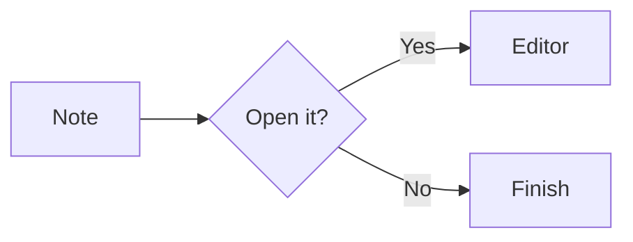
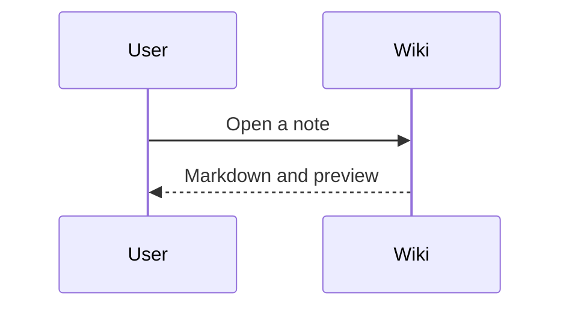

# Diagrams and music notation

This page tests the fully **offline** Mermaid and ABCjs renderers. If a library is unavailable, Markdown source and an explanatory warning remain visible.

## Mermaid — flowchart



## Mermaid — sequence diagram



## ABCjs — sheet music

```abc
X:1
T:Example scale
M:4/4
L:1/4
K:C
C D E F | G A B c |
```

Once both libraries have loaded, the buttons below each rendered diagram or score let you save it as SVG.
