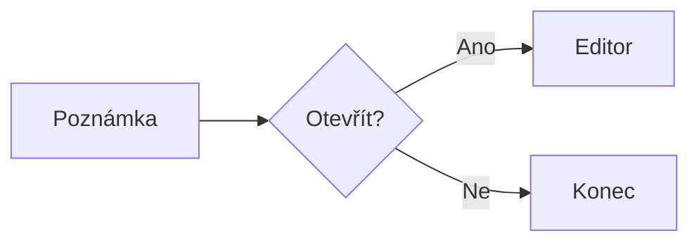
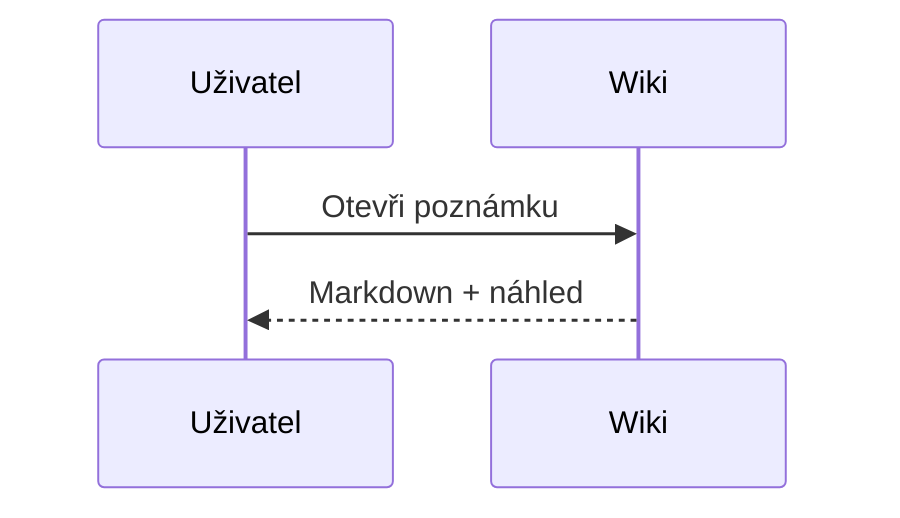

# Diagramy a notový zápis

Tato stránka slouží k ověření **lokálních** rendererů Mermaid a ABCjs. Pokud knihovny ještě nejsou doplněny, uvidíš jejich kód a upozornění.

## Mermaid – procesní diagram



## Mermaid – sekvenční diagram



## ABCjs – notový zápis

```abc
X:1
T:Ukázková stupnice
M:4/4
L:1/4
K:C
C D E F | G A B c |
```

Po načtení obou knihoven lze vykreslený diagram nebo noty uložit jako SVG tlačítkem pod náhledem.
