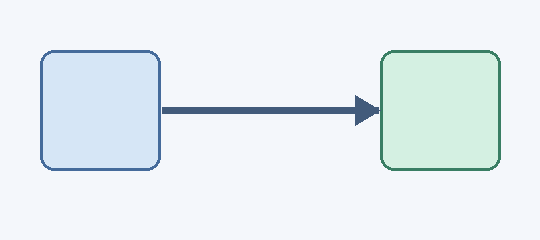

# Ukázková wiki · dávka 8

Tohle je testovací složka. Můžeš ji otevřít **pro čtení i zápis** a zkoušet úpravy bez rizika pro vlastní poznámky.

## Odkazy

- [Python – relativní odkaz](Programovani/Python.md)
- [[Python|Python – Obsidian wiki odkaz]]
- [Mermaid diagram](Diagramy/UML.md)
- [ABC notový zápis](Diagramy/Noty.md)
- [Obsidian metadata, callouty a obrázky](Obsidian-formaty.md)

## Odkazy na nadpisy (dávka 17)

- [Instalace na Windows v Pythonu](Programovani/Python.md#Instalace%20na%20Windows)
- [[Programovani/Python#Úvod|Obsidian odkaz přímo na nadpis]]

## Matematika

Inline vzorec: $E=mc^2$ a $x_1 + y_2 = 3$.

$$
\int_0^1 x^2\,dx = \frac{1}{3}
$$

## Obrázek v podsložce

## Nové v dávce 4

V levém panelu přepni na **Fulltext** a vyhledej slovo `Python` nebo `notový`.

V panelu **Odkazy** se zobrazí obsah aktuální stránky a po kliknutí na tlačítko i zpětné odkazy. Zkus otevřít `Programovani/Python.md` a vyhledat, kdo na něj odkazuje.

Mermaid a ABC notace se vykreslí po jednorázovém doplnění originálních JS knihoven podle `docs/RENDERERY.md`. Bez nich se zdrojový kód zachovává.
