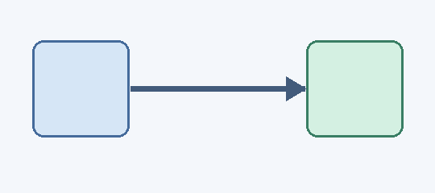

# Welcome to the Local StackEdit Wiki demo

This folder is a **safe example wiki**. Open it in Chrome or Edge with read/write access to test the editor without changing your personal notes.

## Contents

Use these in-document links to verify the navigation both in the **HTML export** and in the **printed PDF**. They should jump directly to the heading rather than merely scroll to the next paragraph.

- [Links between notes](#Links%20between%20notes)
- [Links to headings](#Links%20to%20headings)
- [Mathematics](#Mathematics)
- [Obsidian-compatible attachments](#Obsidian-compatible%20attachments)
- [draw.io / diagrams.net (offline)](#draw.io%20%2F%20diagrams.net%20(offline))

## Links between notes

- [Python – relative Markdown link](Programming/Python.md)
- [[Python|Python – Obsidian wiki link]]
- [Mermaid diagram](Diagrams/UML.md)
- [ABC music notation](Diagrams/Music.md)
- [Obsidian metadata, callouts, and images](Obsidian-formats.md)
- [Diagrams and sheet music](Diagrams-and-music.md)

## Links to headings

- [Installing Python on Windows](Programming/Python.md#Installing%20Python%20on%20Windows)
- [[Programming/Python#Introduction|Obsidian link to Introduction]]

## Mathematics

An inline formula: $E=mc^2$ and $x_1+y_2=3$.

$$
\int_0^1 x^2\,dx = \frac{1}{3}
$$

## Image in a subfolder

## Explore the wiki

Switch the sidebar to **Fulltext** and search for the word `Python` or `music`.

The **Links** panel displays outbound and inbound links. Open `Programming/Python.md` and find out which other notes link to it.

Mermaid and ABC render locally with the bundled, verified JavaScript libraries. You can export finished diagrams as SVG.

## Obsidian-compatible attachments

Open [the attachment examples](Attachments/Examples.md) to test images, audio, video, PDF, Canvas, Bases and draw.io in Markdown. Expand **Attachments** to browse the files individually. Everything stays on your computer.

## Large file-tree test

Read [Tree scrolling and long filenames](Tree-Test/README.md), click **Expand all**, and try horizontal and vertical scrolling. A deeply nested note and a folder with 45 files make it easy to test sidebar resizing and the **Move** action.

## draw.io / diagrams.net (offline)

Open the [two-page diagram](Attachments/example.drawio). Page one contains plain XML and page two standard Base64/DEFLATE-compressed data. The local viewer handles basic shapes, connectors, pages and zoom. Complex diagrams may need diagrams.net for full fidelity.

![[Attachments/example.base]]
![[Attachments/example.canvas]]
![[Attachments/example.drawio]]

![[Attachments/sample.pdf]]
![[Attachments/video.webm]]
![[Attachments/tone.wav]]
