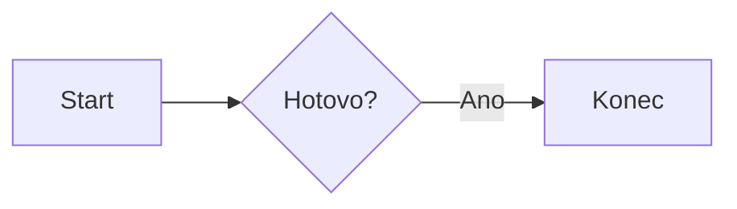

## Dávka 15 – funkční ověření

Po doplnění oficiálních knihoven a obnovení stránky otevři **Renderery → Otestovat skutečné vykreslení**. Zkouška nepracuje s osobními poznámkami a ověří, že knihovny umějí opravdu vygenerovat SVG. Pokud hlásí *chybí*, zkontroluj lokální soubory v `vendor/`; pokud hlásí *chyba*, ulož diagnostický JSON a připoj popis testu. Poslední statusy se do JSON ukládají bez chybových hlášek a názvů souborů.

Poznámka: test v projektu byl automaticky ověřen se simulovaným rozhraním knihoven; **aktuální ZIP neobsahuje reálné Mermaid a ABCjs distribuční soubory**. To je stále nevyřešený distribuční krok.

# Offline renderery diagramů a hudební notace – stav dávky 13

Lokální Wiki zachovává bloky ve formátu `mermaid` a `abc`. **Samotné distribuční JavaScriptové knihovny nejsou přímo v ZIPu**, ale nově je může přes tlačítko **Renderery → Doplnit offline renderery…** stáhnout a uložit sám prohlížeč, bez instalace příkazové řádky. Výběr cílové složky aplikace vyžaduje zvláštní povolení a pro jednorázové stažení je potřeba internet. Zástupné soubory ve `vendor/mermaid/mermaid.min.js` a `vendor/abcjs/abcjs-basic-min.js` neposkytují vykreslování. Po jejich nahrazení oficiálním UMD buildem se náhled automaticky aktivuje bez serveru. Aplikace si nesahá na internet při prohlížení wiki.

## Jednorázové získání knihoven

- **Doporučený postup:** Otevři `index.html`, vyber **Renderery → Doplnit offline renderery…**, povol aplikaci přístup ke složce obsahující `index.html` a po dokončení obnov stránku. Složku wiki nevybírej. Aplikace neukládá soubory do wiki a stahuje oba soubory ještě před prvním zápisem. Pokud knihovny už mají obvyklou velikost, nebudou přepsány.
- **Původ:** pevně dané HTTPS URL na cdnjs, bez odesílání obsahu wiki. Přesný obsah nesrovnáváme s nezávisle ověřenými SHA-256 otisky; do finální verze je žádoucí doplnit kontrolu integrity.


- Windows: v rozbalené složce můžeš spustit `powershell -ExecutionPolicy Bypass -File tools\download-renderers.ps1`.
- Linux / macOS: `sh tools/download-renderers.sh`.
- Skripty stahují verze **Mermaid 8.9.2** a **ABCjs 6.4.4** přes HTTPS přímo do `vendor/`; nestahují žádný software k instalaci ani neupravují původní wiki.
- Zdroj Mermaid: `https://cdnjs.cloudflare.com/ajax/libs/mermaid/8.9.2/mermaid.min.js`.
- Zdroj ABCjs: `https://cdnjs.cloudflare.com/ajax/libs/abcjs/6.4.4/abcjs-basic-min.min.js`.
- Skripty kontrolují minimální délku souborů, ale zatím nemají předem ověřené SHA256 otisky. Verze jsou pevně stanovené; důvěra v HTTPS a CDN zůstává nutná.
- Po doplnění lze aplikaci opět otevřít dvojklikem v Edge/Chrome a od té chvíle by měla používat lokální knihovny. **Skutečná kompatibilita pod `file://` ještě nebyla otestována v desktopovém prohlížeči.**

## Diagnostika a chování

Tlačítko **Renderery** u ovládání editoru vypíše stav Markdown, MathJax, Mermaid a ABCjs podle skutečných JavaScriptových objektů. Stav můžeš ověřit bez otevřené wiki. Když je jeden renderer nepřítomný, zobrazí se u příslušného blokového kódu varování a **zdroj zůstane viditelný**.

Podporované zápisy po doplnění knihoven:

````markdown


```abc
X:1
T:Ukázka
M:4/4
L:1/4
K:C
C D E F | G A B c |
```
````

Adaptér používá `mermaid.mermaidAPI.render()` / `mermaid.initialize()` a `ABCJS.renderAbc()`. Podporuje zpětné volání i Promise u Mermaid. Vykreslené SVG lze stáhnout tlačítkem **Uložit SVG**, Markdown se nemění. Před vložením je SVG omezeno na neaktivní prvky, takže některé exotické styly mohou ztratit část vzhledu.

**Licence:** Mermaid a ABCjs jsou MIT; při distribuci skutečných knihoven je nutné zachovat jejich licenční oznámení. Viz repozitáře https://github.com/mermaid-js/mermaid a https://github.com/paulrosen/abcjs.

## Ověření

`python tests/batch09-smoke.py` ověřuje adaptér vůči simulovaným veřejným rozhraním těchto dvou knihoven. Nepovažuj úspěšný test za důkaz, že **oficiální knihovny skutečně běží** – to bude třeba zkusit na desktopu po jejich doplnění. Syntaxe Mermaid 8.9.2 / ABCjs 6.4.4 se mohou lišit od nejnovějších verzí i od původního StackEditu.
